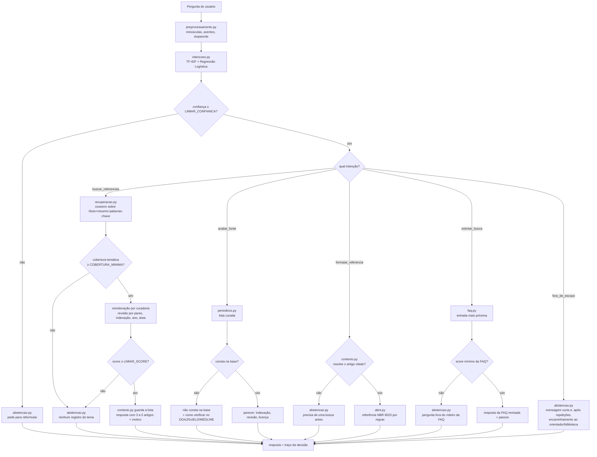
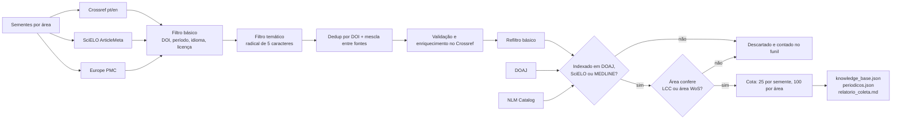

# Fluxograma do Artikel (Opção C — híbrida)

O documento do projeto pede, no Marco 3, "arquitetura justificada, comparação com a Opção D,
fluxograma e limiares". Este arquivo é a fonte do fluxograma; `docs/fluxograma.png` deve ser
gerado a partir dele para o relatório.

## Decisão da pergunta

Todo caminho termina em `fluxo.py`, que monta a resposta **e** o traço da decisão (intenção,
confiança, ação, regra aplicada, número de candidatos, score máximo e se o contexto foi
usado). É esse traço que a interface mostra no painel recolhível e que serve de evidência do
requisito R4 na demonstração.

## Pipeline de coleta (Marco 2)

## Comparação com a Opção D (LLM + recuperação)

| Critério | Opção C (escolhida) | Opção D (LLM + recuperação) |
|---|---|---|
| Risco de citação inventada | Zero: a resposta só exibe texto da base curada | Alto: o modelo pode inventar referência plausível |
| Cumpre R3 ("IA implementada pela equipe") | Sim: classificador e recuperação são da equipe | Sozinha, não: o mecanismo passa a ser o serviço externo |
| Custo e dependência | Só bibliotecas locais e gratuitas | Serviço externo, latência e possível chave de API |
| Explicabilidade | Alta: cada resposta traz o traço da decisão e o motivo de cada artigo | Baixa: a decisão fica dentro do modelo |
| Qualidade do texto | Rígida e previsível (é o aceitável para o escopo) | Mais fluida |
| Aderência às restrições do projeto | Total (sem chave de API, sem dado pessoal) | Exige aprovação do professor e declarar uso de IA |

A Opção C foi mantida porque o diferencial do Artikel é justamente **não** inventar
referência; o texto mais fluido da Opção D não compensa reintroduzir o risco que o projeto
existe para eliminar.

## Limiares (revisão prevista para o Marco 3)

| Limiar | Onde | Valor atual | Como foi escolhido |
|---|---|---|---|
| `LIMIAR_CONFIANCA` | `app/config.py` | 0,35 | Abaixo disso a probabilidade do classificador não se distingue entre intenções |
| `LIMIAR_SCORE` | `app/config.py` | 0,10 | Piso de similaridade para recomendar |
| `COBERTURA_MINIMA` | `app/config.py` | 0,34 | Exige ao menos um termo de conteúdo da pergunta no artigo |
| `TOP_K` | `app/config.py` | 5 | "Top 3–5 artigos" do documento |
| Bônus de curadoria | `app/config.py` | 0,02–0,06 | Pequenos de propósito: desempatam, não substituem relevância |

Os valores devem ser revistos com a distribuição de scores de `tests/avaliar.py` no Marco 3,
como o próprio documento prevê (pendência 8).
